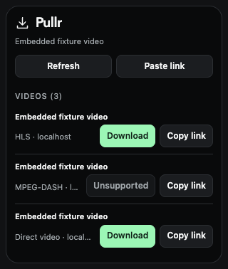
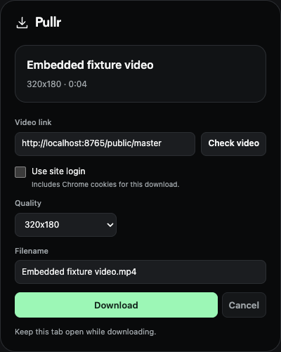

# Pullr for Windows

Chrome-only video downloader · **0.3.0**

This branch packages Pullr's browser downloader for Windows. It captures embedded videos, saves supported direct files and HLS streams locally, and queues downloads one at a time. No account, daily quota, paid tier, artificial wait timer, or desktop helper is required.

**[Download the extension ZIP](https://github.com/Italian-seasoning/Pullr/raw/refs/heads/windows-distribution/windows/packages/PullrChrome.zip)** · [Installation instructions](windows/INSTALL.md) · [Privacy](windows/chrome-extension/PRIVACY.md)

## Install

1. Download and extract the ZIP into a permanent folder.
2. Open `chrome://extensions` and enable **Developer mode**.
3. Click **Load unpacked** and select the extracted folder containing `manifest.json`.
4. Pin Pullr, reload the video page, play the video, and open the extension.

Requires desktop Chrome 125 or newer. This is an unpacked Chrome extension; it has not been published to the Chrome Web Store. See the [full Windows guide](windows/INSTALL.md) for downloads, queue behavior, updates, and removal.

## Interface

Dark mode only, visible button labels, title-first video summaries, full-width filenames, and vertical progress. Confirmed HLS quality playlists are grouped together. **Paste link** reads the copied video URL. Completed downloads show **Saved** and **Download again**.

<p>
  
  
</p>

## Compatibility

Supports direct MP4/WebM/MOV/M4V, completed combined-audio/video HLS, master-playlist quality selection, byte ranges, supported MPEG-TS to MP4 packaging, fragmented MP4, and ordinary AES-128 HLS with accessible keys.

DASH, separate audio-track merging, DRM, live recording, timeline/codec switches, site-specific extractors, and restart/resume are not implemented. Sites may reject inaccessible or expired URLs.

## Source and packaging

The standalone extension source is in [windows/chrome-extension](windows/chrome-extension). The repository's older macOS bridge in `chrome-extension` is a separate component. The native macOS distribution remains on [main](https://github.com/Italian-seasoning/Pullr/tree/main).

The runtime ZIP contains only extension files. [Source ZIP](windows/packages/PullrChrome-source.zip) includes documentation and checks. Rebuild both archives with Python 3:

```sh
python windows/package.py
```

Run the portable Node checks:

```sh
cd windows/chrome-extension
node tests/test_dlp.cjs
node tests/test_groups.cjs
node test_stream_capture.js
node test_page_capture.js
node test_background.js
```

The capture hooks reuse Pullr's existing code; the browser downloader handles fetching, playlist parsing, encryption keys, disk writes, cancellation, and queue coordination. MP4 packaging uses bundled [mux.js](https://github.com/videojs/mux.js) with its included Apache 2.0 license. All executable code is bundled locally.

## Validation

Node checks and the Chrome workflow passed, including grouped iframe capture, queue handoff, opt-in site login, cancellation preserving existing files, and temporary header-rule cleanup. Screenshots use generated local fixtures. The published files and ZIP contents were checked for personal identifiers, credentials, and absolute personal file paths.

Browser automation ran on macOS and substituted fixture APIs for native Save As and OS clipboard reads. Windows Chrome and those native permission/dialog flows remain untested. See the [validation record](windows/chrome-extension/VALIDATION.md).
